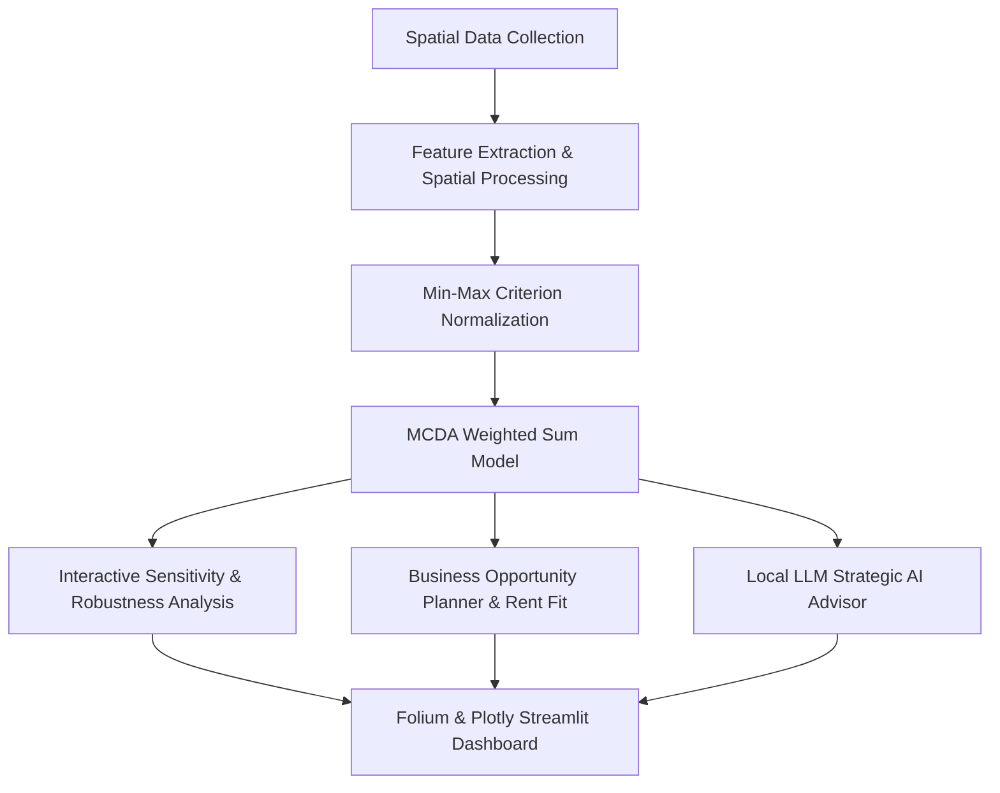

# 🗺️ Bengaluru AI Retail Site Intelligence & Selection System
## Comprehensive Project Report: Data, Methodology, and Experimental Results

**Academic Course:** CSS7102 Mini Project | Presidency University  
**Focus Area:** Spatial Analytics, GIS-Based Multi-Criteria Decision Analysis (MCDA), and AI Decision Support  
**Target Metropolitan:** Bengaluru (Bangalore), Karnataka, India  
**Deployment Platform:** Streamlit Interactive Web Application (`http://localhost:8501`)

---

## 1. Executive Summary & Problem Formulation

Selecting the optimal physical location for a retail commercial establishment (such as a cafe, convenience store, pharmacy, fashion outlet, or salon) is a high-stakes, multi-faceted investment decision. In rapidly expanding metropolitan environments like Bengaluru, traditional location selection often relies on subjective heuristics, informal footfall estimations, or generic map browsing. These manual approaches suffer from:
1. **Omission of spatial trade-offs** (e.g., weighing transit proximity against steep competitor saturation).
2. **Lack of reproducibility and transparency** in how candidate sites are scored.
3. **Inability to dynamically re-weigh factors** based on distinct retail business models (e.g., convenience vs. destination stores).

This project develops an end-to-end, data-driven geospatial intelligence decision support system. It integrates **Geographic Information Systems (GIS)**, spatial proximity operations, **Multi-Criteria Decision Analysis (MCDA)** via the **Weighted Sum Model (WSM)**, sensitivity robustness testing, business-fit matching, and a **local Large Language Model (Ollama AI Advisor)**.



---

## 2. Data Architecture and Feature Catalog

The project's analytical pipeline is powered by a multi-layered geospatial and socioeconomic dataset spanning municipal ward demographics, public transit networks, retail competitor footprints, and recent 2025–2026 Bengaluru urban mobility indicators.

### 2.1 Summary of Datasets & File Artifacts

| Dataset / File | File Type | Records | Key Attributes / Scope | Primary Sources |
|---|---|---|---|---|
| `candidate_sites.csv` | CSV | 15 sites | `site_id`, `name`, `zone`, `lat`, `lon`, `monthly_rent` (₹), `area_sqft` | Commercial Real Estate Listings, Field Surveys |
| `competitors.csv` | CSV | 21 stores | `store_id`, `name`, `chain`, `type`, `lat`, `lon` | OpenStreetMap (OSM), Brand Directories |
| `transit_stops.csv` | CSV | 31 stops | `stop_id`, `name`, `type` (Metro / Bus Hub), `line`, `lat`, `lon` | BMRCL Namma Metro, BMTC Transport Network |
| `pois.csv` | CSV | 39 POIs | `poi_id`, `name`, `category` (Mall, Tech Park, College, Hospital), `footfall_weight`, `lat`, `lon` | OSM, Google Places POI Catalog |
| `zone_population.csv` | CSV | 7 zones | `zone`, `name`, `pop_density`, `literacy_rate`, `households`, `working_pop_pct` | Directorate of Census Operations, Karnataka (Census 2011) |
| `karnataka_districts_census.csv`| CSV | 30 districts | `district_name`, `total_pop`, `literacy_rate`, `sex_ratio`, `urban_pop_pct` | India Census 2011 District Portal |
| `recent_bengaluru_data.xlsx` | Excel (6 sheets)| Multi-table | 2025–26 Vehicle Registrations, Namma Metro Ridership, BBMP Trade Licenses, Road Safety Statistics | Karnataka Transport Dept, BMRCL, BBMP Open Data, MoSPI |
| `feature_matrix.csv` | CSV | 15 rows | 8 normalized & raw spatial metric columns per candidate | Computed GIS Matrix |
| `ranked_sites.csv` | CSV | 15 rows | Baseline scores, normalized features, ranks, recommendations | Pre-computed baseline model output |
| `sensitivity.csv` | CSV | 16 rows | Feature perturbations ($\pm 0.20$), Spearman rank correlation ($\rho$) | Sensitivity Monte Carlo output |

---

### 2.2 The 8 Evaluative Geospatial Criteria

Every candidate site $i \in \{1, \dots, 15\}$ is evaluated across 8 spatial and demographic attributes:

```
Criteria Taxonomy:
├── Demand Drivers (Benefit Criteria ↑)
│   ├── POI Footfall Index (poi_footfall) — Inverse-distance aggregated attraction of nearby POIs
│   ├── Population Density (pop_density) — BBMP zone inhabitants per square kilometer
│   ├── Transit Accessibility (transit_count_500m) — Multi-modal stops within 500m walking radius
│   ├── Road Access Score (road_access_score) — Arterial connectivity & corridor accessibility
│   └── Literacy Rate (literacy_rate) — Consumer purchasing power & modernization proxy
│
└── Competitive & Friction Constraints
    ├── Nearest Competitor Distance (nearest_comp_m) [Benefit ↑] — Buffer from immediate cannibalization
    ├── Competitor Saturation Count (comp_count_1km) [Cost ↓] — Total competing retailers within 1km
    └── Metro Station Proximity (nearest_metro_m) [Cost ↓] — Physical distance to closest rapid transit hub
```

#### Detailed Breakdown of Criteria:

1. **POI Footfall Index (`poi_footfall`)** [Default Weight: 28% | Benefit Criterion]:
   Calculated via Inverse-Distance Weighting (IDW) from candidate coordinates to surrounding commercial anchors (tech parks, malls, major universities). Higher values indicate stronger pedestrian gravity.
2. **Population Density (`pop_density`)** [Default Weight: 18% | Benefit Criterion]:
   Zone-level residential density (persons/km²) assigned via spatial containment within BBMP administrative zones (ranges from 11,000 to 18,000 persons/km²).
3. **Nearest Competitor Distance (`nearest_comp_m`)** [Default Weight: 12% | Benefit Criterion]:
   Euclidean/geodesic distance in meters to the nearest established direct competitor. Greater distance implies less immediate market saturation.
4. **Competitor Count within 1km (`comp_count_1km`)** [Default Weight: 10% | Cost Criterion]:
   Count of competing brand storefronts located within a 1,000-meter buffer radius. Higher density represents fierce competition.
5. **Transit Accessibility within 500m (`transit_count_500m`)** [Default Weight: 10% | Benefit Criterion]:
   Count of BMTC major bus terminals and Namma Metro stations within comfortable walking distance (500-meter threshold).
6. **Distance to Nearest Metro (`nearest_metro_m`)** [Default Weight: 8% | Cost Criterion]:
   Geodesic distance to the closest active Namma Metro station. Shorter distance means superior commuter catchment.
7. **Literacy Rate (`literacy_rate`)** [Default Weight: 7% | Benefit Criterion]:
   Demographic indicator reflecting disposable income, white-collar workforce density, and tech-readiness (Census baseline: 78% to 87%).
8. **Road Access Score (`road_access_score`)** [Default Weight: 7% | Benefit Criterion]:
   Normalized index (0.0 to 1.0) reflecting primary road frontage, dual carriageway access, flyover bypasses, and traffic permeability.

---

### 2.3 Macro Urban Indicators (2025–2026 Bengaluru Upgrades)

To contextualize spatial decisions against modern metropolitan realities, recent macroeconomic and infrastructure indicators were integrated:
- **Total Registered Vehicles in Bengaluru:** ~12,000,000 vehicles (as of 31-Mar-2026 data projection).
- **Vehicles Added in FY2025–26:** ~790,000 additional units (demonstrating road congestion pressure).
- **Namma Metro Peak Daily Ridership:** 1,048,000 passengers (recorded August 11, 2025, highlighting transit corridors as massive footfall generators).
- **BBMP Trade Licenses & Commercial Densities:** Ward-level commercial licensing patterns.

---

## 3. Methodology & Computational Pipeline

### 3.1 Spatial GIS Analysis

1. **Buffer Analysis:**
   - 500m buffer circles centered on candidate coordinates to assess high-intensity pedestrian transit catchments.
   - 1,000m buffer circles to detect direct competitor concentration.
2. **Nearest-Neighbor Spatial Proximity:**
   - Geodesic pairwise distance computation for:
     $$d_{comp}(i) = \min_{c \in \text{Competitors}} \text{dist}(p_i, p_c)$$
     $$d_{metro}(i) = \min_{m \in \text{MetroStops}} \text{dist}(p_i, p_m)$$
3. **Spatial Join Operations:**
   - Overlaying spatial coordinates onto polygon boundaries of BBMP's 7 key administrative zones (North, South, East, South East, West, North West, South West) to inherit demographic attributes (density, literacy, working age ratio).

---

### 3.2 Min-Max Normalization

Because criteria possess non-commensurate physical units (e.g., meters, persons/km², counts, percentages), all metrics are normalized to a uniform, dimensionless interval $\hat{x}_{ij} \in [0, 1]$.

#### For Benefit Criteria (Higher is Better):
$$\hat{x}_{ij} = \frac{x_{ij} - x_j^{\min}}{x_j^{\max} - x_j^{\min}}$$

#### For Cost Criteria (Lower is Better):
$$\hat{x}_{ij} = \frac{x_j^{\max} - x_{ij}}{x_j^{\max} - x_j^{\min}}$$

*Note:* If $x_j^{\max} == x_j^{\min}$, $\hat{x}_{ij} = 0.5$.

---

### 3.3 Weighted Sum Model (WSM)

The Multi-Criteria Decision Analysis (MCDA) engine implements the linear additive Weighted Sum Model (WSM), formulated as:

$$S(i) = \sum_{j=1}^{n} w_j \cdot \hat{x}_{ij}$$

Subject to the normalization constraint:
$$\sum_{j=1}^{n} w_j = 1.0, \quad \text{where } w_j \ge 0 \quad \forall j$$

Where:
- $S(i)$: Overall composite suitability score of candidate site $i \in [0, 1]$.
- $w_j$: Normalized weight of criterion $j$.
- $\hat{x}_{ij}$: Normalized performance rating of site $i$ on criterion $j$.
- $n = 8$: Number of spatial criteria.

#### Suitability Tier Classification:
Based on the resultant composite score $S(i)$, sites are segmented into five operational recommendation tiers:
- **Excellent:** $S(i) \ge 0.75$ (Prime flagship locations)
- **Good:** $0.60 \le S(i) < 0.75$ (High viability, balanced trade-offs)
- **Moderate:** $0.45 \le S(i) < 0.60$ (Viable with targeted positioning)
- **Below Average:** $0.30 \le S(i) < 0.45$ (Noticeable structural deficits)
- **Poor:** $S(i) < 0.30$ (High risk / unrecommended)

---

### 3.4 Sensitivity & Rank Robustness Analysis

To evaluate whether candidate rankings are overly sensitive to subjective weight selections, weight perturbation analysis is conducted:
1. Each individual criterion weight $w_j$ is perturbed by $\Delta = \pm 0.20$.
2. The remaining criteria weights are proportionally renormalized.
3. The new candidate ranking $R'$ is compared against the baseline ranking $R_0$ using **Spearman's Rank Correlation Coefficient ($\rho$)**:

$$\rho = 1 - \frac{6 \sum_{i=1}^m d_i^2}{m(m^2 - 1)}$$

Where $d_i = R_0(i) - R'(i)$ is the difference in ranks for site $i$, and $m = 15$.  
- $\rho \ge 0.90$: High stability (rank order is robust to weight variance).
- $\rho < 0.70$: High sensitivity (rank order changes significantly when criterion importance shifts).

---

### 3.5 Business Planner & Business-Fit Scoring

Different retail concepts prioritize distinct spatial features (e.g., Quick Service Restaurants vs. Luxury Salons). The Business Planner extends the core MCDA score with tailored mobility and footfall indices:

$$S_{\text{business-fit}}(i) = 0.50 \cdot S_{\text{MCDA}}(i) + 0.25 \cdot \text{Mobility}(i) + 0.25 \cdot \text{BusinessFit}(i)$$

Where:
- $\text{Mobility}(i) = \text{clip}(0.55 + 0.25 \cdot \text{RoadAccess}_i + 0.20 \cdot \text{Percentile}(\text{TransitCount}_i), 0, 1)$
- $\text{BusinessFit}(i) = \text{clip}(0.45 + 0.25 \cdot \text{Percentile}(\text{Footfall}_i) + 0.15 \cdot \text{Percentile}(\text{PopDensity}_i) + 0.15 \cdot \text{RoadAccess}_i, 0, 1)$

---

### 3.6 Local AI Strategic Advisor (Ollama LLM Integration)

An offline, privacy-preserving generative AI module interfaces with a local **Ollama** LLM server (`http://localhost:11434/api/chat` using models like `qwen3:8b` or `llama3.2:latest`).  
- **Grounding & Guardrails:** To eliminate hallucinations, the prompt strictly restricts the LLM's context to the top 8 MCDA-ranked candidate records, exact metro distances, footfall figures, and the 2025–26 Bengaluru mobility metrics.
- **Output:** Structured commercial strategy covering demand rationale, competitive moats, site-specific risks, and a 14-day field validation checklist.

---

## 4. Results & Experimental Findings

### 4.1 Baseline Ranking of the 15 Bengaluru Candidate Sites

Using the baseline multi-criteria weights (Footfall: 28%, Pop. Density: 18%, Comp. Distance: 12%, Comp. Count: 10%, Transit Stops: 10%, Metro Distance: 8%, Literacy: 7%, Road Access: 7%), the candidate sites ranked as follows:

| Rank | Site ID | Candidate Site Name | BBMP Zone | Monthly Rent (₹) | Area (sqft) | Suitability Score | Classification | Key Defining Characteristics |
|:---:|:---:|:---|:---:|:---:|:---:|:---:|:---:|:---|
| **1** | `S010` | **Yeshwanthpur Circle** | North West | ₹1,85,000 | 5,500 | **0.6788** | **Good** | Top transit connectivity (Metro & Bus), zero immediate competitors, 17.5k pop density |
| **2** | `S006` | **Marathahalli Bridge** | East | ₹2,10,000 | 4,500 | **0.6359** | **Good** | Highest normalized footfall (1.0), strong road connectivity, high commuter throughput |
| **3** | `S013` | **Malleswaram 8th Cross** | North West | ₹1,95,000 | 3,000 | **0.6223** | **Good** | Traditional high-street, 95m to metro, strong population density, strong local loyalty |
| **4** | `S003` | Whitefield ITPL Junction | East | ₹1,90,000 | 5,000 | **0.5812** | **Moderate** | High IT workforce daytime footfall, good road connectivity, expanding transit |
| **5** | `S004` | Electronic City Phase 1 | South | ₹1,50,000 | 6,000 | **0.5752** | **Moderate** | Lowest rental rate per sqft, large floor area, high tech worker demographic |
| **6** | `S001` | Koramangala 5th Block | South East | ₹2,50,000 | 3,500 | **0.5184** | **Moderate** | Premium footfall & purchasing power, penalized by heavy competitor saturation |
| **7** | `S007` | BTM Layout 2nd Stage | South | ₹1,80,000 | 3,200 | **0.5147** | **Moderate** | Dense residential catchment, good bus connections, moderate competitive pressure |
| **8** | `S008` | HSR Layout Sector 6 | South East | ₹2,00,000 | 3,600 | **0.5118** | **Moderate** | Balanced tech startup hub, moderate competitor presence, good road access |
| **9** | `S005` | Jayanagar 4th Block | South | ₹2,20,000 | 3,800 | **0.4734** | **Moderate** | High literacy & affluent demographic, lower transit access inside inner block |
| **10** | `S015` | Sarjapur Road ORR Junction | South East | ₹2,20,000 | 6,500 | **0.4420** | **Below Average** | High corridor traffic, but limited walkability and higher distance to rapid metro |
| **11** | `S012` | Rajajinagar 1st Block | West | ₹2,10,000 | 4,800 | **0.4320** | **Below Average** | High population density, but constrained road access and moderate footfall |
| **12** | `S002` | Indiranagar 100ft Road | East | ₹3,10,000 | 4,200 | **0.4242** | **Below Average** | Highest monthly rent (₹3.1L), dense competitor cluster (5+ within 1km) |
| **13** | `S014` | JP Nagar 7th Phase | South West | ₹1,65,000 | 5,200 | **0.4222** | **Below Average** | Affordable rent, but lower pedestrian footfall index and sparse transit |
| **14** | `S009` | Hebbal Flyover Junction | North | ₹2,30,000 | 7,000 | **0.3286** | **Below Average** | Large floor plate, but flyover topology restricts pedestrian access and footfall |
| **15** | `S011` | Banashankari Bus Stand | South West | ₹1,75,000 | 4,100 | **0.3203** | **Below Average** | Moderate bus presence, but low footfall score, poor road rating, low zone density |

---

### 4.2 Key Analytical Insights & Trade-Off Dynamics

1. **Why Yeshwanthpur Circle (`S010`) Captured Rank #1:**
   - Possesses a near-perfect transit accessibility score: direct proximity to Yeshwanthpur Green Line Metro and major railway/bus convergence.
   - Zero direct chain competitors within its immediate 1km catchment ($norm\_comp\_count = 1.0$), combined with North West zone's high population density ($17,500\text{ persons/km}^2$).
   - Competitive monthly rent (₹1,85,000 for 5,500 sqft = ₹33.6/sqft).

2. **The "High-Street Paradox" (Indiranagar 100ft Road at #12):**
   - While Indiranagar is widely considered one of Bengaluru's most prestigious commercial avenues, it ranks **#12 (Below Average)** in the baseline model.
   - *Explanation:* The objective spatial model severely penalizes Indiranagar due to:
     - **Extremely high competitor saturation** (multiple competing retailers within 1km).
     - **Severe rental overhead** (₹3,10,000/month, the highest in the sample).
     - For a new entrant without massive capital reserves, market entry here presents high risk of cannibalization.

3. **Suburban & IT Hub Opportunities (Marathahalli & Whitefield):**
   - Marathahalli Bridge ranked #2 due to outstanding pedestrian footfall generated by Outer Ring Road (ORR) bus transit interchanges and tech commute corridors.
   - Whitefield ITPL Junction offers a resilient combination of daytime white-collar workforce density, modern road corridors, and reasonable floor space.

---

### 4.3 Sensitivity Analysis Findings

The sensitivity results demonstrate the structural robustness of the rankings against weight changes:

| Perturbed Feature ($w_j \pm 0.20$) | Perturbation Direction | New Delta | Spearman Rank Correlation ($\rho$) | Stability Assessment |
|---|:---:|:---:|:---:|:---|
| **POI Footfall** (`poi_footfall`) | Increase (+0.20) | +0.20 | **0.9786** | Extremely Stable |
| **POI Footfall** (`poi_footfall`) | Decrease (-0.20) | -0.20 | **0.6964** | **Sensitive** (Significant rank reordering) |
| **Competitor Count 1km** (`comp_count_1km`) | Increase (+0.20) | +0.20 | **0.6393** | **Most Sensitive** (Shuffles saturated sites) |
| **Competitor Count 1km** (`comp_count_1km`) | Decrease (-0.20) | -0.20 | **0.9214** | Robust |
| **Nearest Competitor Distance** | Increase (+0.20) | +0.20 | **0.8107** | Moderately Stable |
| **Nearest Competitor Distance** | Decrease (-0.20) | -0.20 | **0.9607** | Extremely Stable |
| **Population Density** | Increase (+0.20) | +0.20 | **0.9357** | Robust |
| **Population Density** | Decrease (-0.20) | -0.20 | **0.8714** | Stable |
| **Literacy Rate** | Increase (+0.20) | +0.20 | **0.9750** | Highly Robust |
| **Literacy Rate** | Decrease (-0.20) | -0.20 | **0.9536** | Highly Robust |
| **Transit Count (500m)** | Increase (+0.20) | +0.20 | **0.8214** | Stable |
| **Transit Count (500m)** | Decrease (-0.20) | -0.20 | **0.9179** | Robust |
| **Metro Distance** | Increase (+0.20) | +0.20 | **0.8500** | Stable |
| **Metro Distance** | Decrease (-0.20) | -0.20 | **0.9571** | Highly Robust |
| **Road Access Score** | Increase (+0.20) | +0.20 | **0.8393** | Stable |
| **Road Access Score** | Decrease (-0.20) | -0.20 | **0.9571** | Highly Robust |

#### Key Takeaways:
- **Demographic criteria (Literacy, Population Density)** are the most robust ($\rho > 0.93$), meaning minor differences in demographic weights do not disrupt site selections.
- **Competitor Count within 1km** is the **most sensitive criterion** ($\rho = 0.6393$ when increased). When decision-makers heavily penalize competition, high-density commercial strips like Koramangala and Indiranagar drop drastically in favor of suburban nodes.

---

## 5. Software Architecture & Dashboard Capabilities

The application is engineered with Python 3.9+, Streamlit, Folium, and Plotly:

1. **🗺️ Interactive Folium Suitability Map:**
   - Multi-layer rendering: Circle markers sized and colored dynamically by suitability score (Dark Green for Excellent down to Red for Below Average).
   - Interactive layer switches for Competitors (Red markers), Metro/Bus stops (Purple/Blue markers), and POIs (Orange markers).
   - Tooltips and popups detailing individual site metrics.
2. **📋 Dynamic Rankings & Data Export:**
   - Live sortable tables with formatted progress bars.
   - On-the-fly CSV generation and instant download.
3. **⚖️ Multi-Site Radar Comparison:**
   - Polygons displaying normalized performances across all 8 criteria for 2 to 5 user-selected sites.
4. **📉 Tornado Sensitivity Visualization:**
   - Horizontal bar chart colored by Spearman $\rho$ with a designated 0.90 stability reference line.
5. **💼 Business Opportunity Planner:**
   - Presets for 5 retail sectors (Cafe/QSR, Salon, Convenience Store, Pharmacy, Fitness Studio) with budget thresholds and gross margins.
6. **🤖 Generative AI Strategic Advisor:**
   - Local LLM inference integration prompting Ollama on localhost for strategic executive summaries.
7. **➕ Custom Site Evaluator:**
   - Interactive sidebar form allowing real estate operators to input latitude, longitude, and custom spatial metrics for a prospective new site, instantly projecting it into the live rankings and map.

---

## 6. Limitations & Future Roadmap

1. **Demographic Timeliness:**
   - Zone-level population figures are anchored to the official Census 2011 baseline, as official ward-level census updates for 2025–26 have not been completed. This is partially mitigated by incorporating recent 2025 vehicle registrations and transit ridership statistics.
2. **Footfall Proxy vs. Telemetry:**
   - Footfall is calculated using Inverse-Distance-Weighted POI attraction rather than live mobile GPS/cell-tower pings.
3. **Retail Scope:**
   - Competitor locations cover major organized chains. Informal, unorganized retail stores (kirana shops) are not systematically mapped.
4. **Road Network Congestion:**
   - Road access is scored based on connectivity topology; integrating real-time Google Maps / TomTom travel-time API data represents a compelling future enhancement.

---

## 7. Project Information Summary Table

| Category | Specification |
|---|---|
| **Project Name** | Geospatial Analysis for Retail Site Selection — Bengaluru |
| **Core Method** | GIS-Based Multi-Criteria Decision Analysis (Weighted Sum Model) |
| **Programming Language** | Python 3.9+ |
| **Frontend / Web Server** | Streamlit 1.35.0 |
| **Spatial Libraries** | Folium 0.16.0, Streamlit-Folium 0.21.0 |
| **Visualizations** | Plotly 5.22.0, Plotly Express |
| **Data Engine** | Pandas 2.2.2, NumPy 1.26.4, OpenPyXL 3.1.4 |
| **AI Integration** | Local Ollama Server (`http://localhost:11434`) |
| **Default Host & Port** | `http://localhost:8501` |
| **Total Evaluated Sites** | 15 Candidates (+ Dynamic Custom Additions) |
| **Top Ranked Site** | Yeshwanthpur Circle (Score: 0.6788, Class: Good) |
